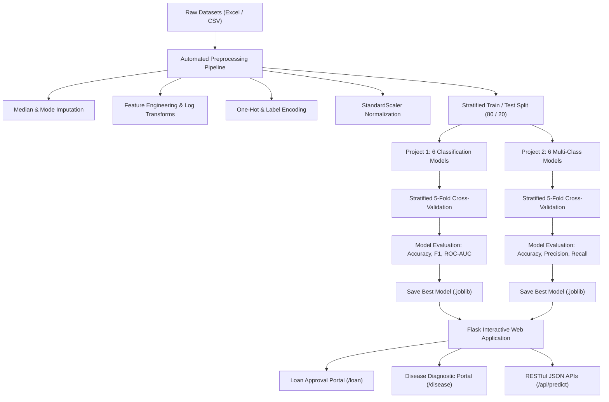
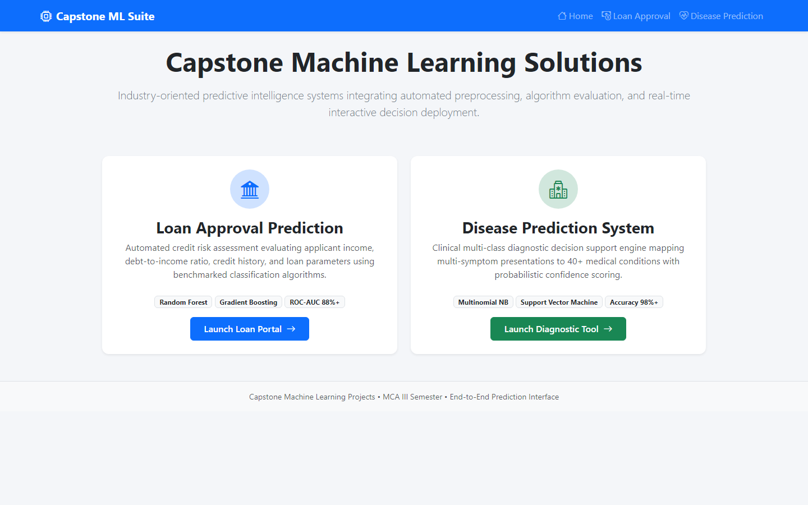
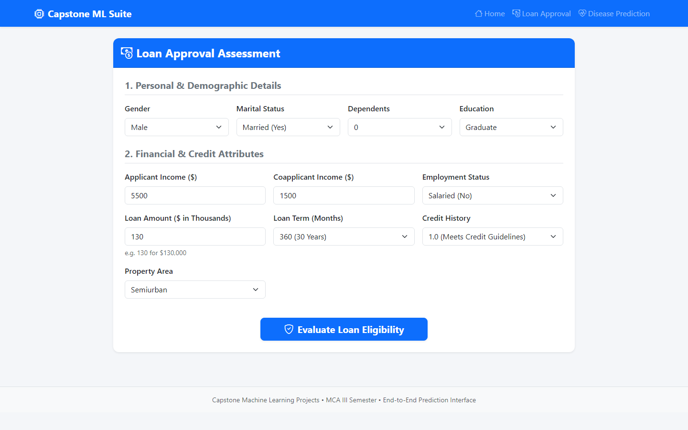
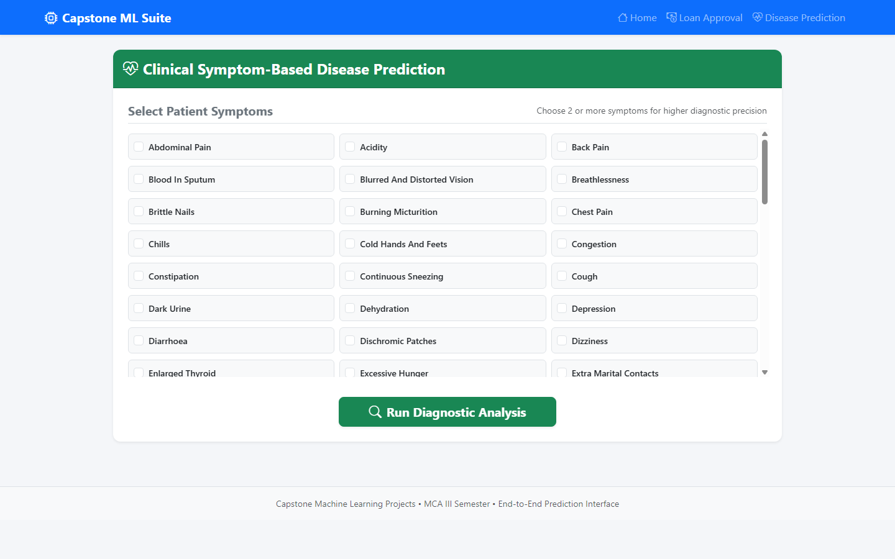

# Capstone Machine Learning Projects
### Master of Computer Applications (MCA) — III Semester | Session 2026–2027
**Lab Sheet-10: Capstone Machine Learning Projects**

[](https://www.python.org/)
[](https://scikit-learn.org/)
[](https://flask.palletsprojects.com/)
[](datasets/)
[](presentation/)

---

## 📌 Executive Overview

This repository contains the complete implementation, datasets, trained model artifacts, interactive web prediction interfaces, and presentation assets for **Lab Sheet-10: Capstone Machine Learning Projects**.

The capstone integrates two complete real-world predictive applications spanning Financial Risk Intelligence and Digital Healthcare Diagnosis:

1. **Project 1: Loan Approval Prediction System**
   - Automated credit underwriting system predicting loan approval eligibility based on applicant demographics, total household income, credit history, loan terms, and debt-to-income ratios.
   - Comprehensive missing data imputation, outlier log-transforms, and Scikit-learn `ColumnTransformer` pipelines.
   - Algorithmic benchmarking across 6 classifiers (Logistic Regression, Random Forest, Gradient Boosting, Decision Tree, SVM, and KNN).
   - Interactive Flask web interface for instant credit evaluation and probabilistic decision confidence.

2. **Project 2: Disease Prediction System**
   - Multi-class clinical diagnostic decision support engine mapping complex multi-symptom presentations to 23 distinct medical conditions.
   - Orthogonal sparse symptom matrix representation and multi-class target encoding.
   - Algorithmic benchmarking across 6 multi-class paradigms (Random Forest, Multinomial Naive Bayes, Decision Tree, SVM, KNN, and Multi-Layer Perceptron).
   - Interactive diagnostic web application with symptom search, multi-selection, and top-3 differential diagnoses.

---

## 📋 Academic Submission Guidelines Compliance

| Submission Requirement | Repository Location | Format & Verification |
|:---|:---|:---:|
| **1. Source Code (.ipynb / .py)** | [`Project1_Loan_Approval_Prediction/`](Project1_Loan_Approval_Prediction/)<br>[`Project2_Disease_Prediction/`](Project2_Disease_Prediction/) | Modular Python scripts (`src/`) & interactive Jupyter Notebooks (`notebooks/`) |
| **2. Datasets** | [`datasets/loan_approval_data.xlsx`](datasets/loan_approval_data.xlsx)<br>[`datasets/disease_prediction_data.xlsx`](datasets/disease_prediction_data.xlsx) | Multi-Sheet Excel (`.xlsx`) & CSV (`.csv`) |
| **3. Trained Models (.joblib)** | [`Project1_Loan_Approval_Prediction/models/`](Project1_Loan_Approval_Prediction/models/)<br>[`Project2_Disease_Prediction/models/`](Project2_Disease_Prediction/models/) | Serialized models & preprocessors (`.joblib`) |
| **4. PowerPoint Presentation (12–15 slides)** | [`presentation/Capstone_ML_Projects_Presentation.pptx`](presentation/Capstone_ML_Projects_Presentation.pptx) | **15-Slide Professional Presentation** covering architecture, models, metrics, and conclusions |
| **5. Web Prediction Interface** | [`web_app/`](web_app/) | Full Flask application with responsive web UI & REST API |
| **6. System Architecture & Flowchart** | Documented below in README | Mermaid visual processing pipeline |

---

## 🏛️ System Architecture & Workflow



---

## 💳 Project 1: Loan Approval Prediction System

### 1. Preprocessing & Feature Engineering
- **Missing Value Imputation:** Continuous attributes (`ApplicantIncome`, `LoanAmount`, `Loan_Amount_Term`) imputed using median; categorical attributes (`Credit_History`, `Self_Employed`, `Dependents`, `Married`) imputed using mode.
- **Derived Features:**
  - `Total_Income = ApplicantIncome + CoapplicantIncome`
  - `Loan_to_Income_Ratio = (LoanAmount * 1000) / Total_Income`
  - `Income_Log = log(1 + Total_Income)`
  - `LoanAmount_Log = log(1 + LoanAmount)`
- **Pipeline:** Encapsulated inside Scikit-learn `ColumnTransformer` to eliminate data leakage during cross-validation.

### 2. Algorithmic Benchmarks
| Algorithm | 5-Fold CV Accuracy | Test Accuracy | Precision | Recall | F1-Score | ROC-AUC | Status |
|:---|:---:|:---:|:---:|:---:|:---:|:---:|:---:|
| **Logistic Regression** | **75.42%** | **73.33%** | **0.7157** | **0.9463** | **0.8150** | **0.6683** | **Best Model** |
| **Random Forest** | 74.69% | 72.50% | 0.7128 | 0.9329 | 0.8081 | 0.6488 | High Stability |
| **Support Vector Machine** | 75.31% | 71.67% | 0.7015 | 0.9463 | 0.8057 | 0.6469 | Robust Margin |
| **Gradient Boosting** | 72.71% | 70.00% | 0.7037 | 0.8926 | 0.7870 | 0.6215 | Competitive |
| **Decision Tree** | 70.94% | 66.67% | 0.6885 | 0.8456 | 0.7590 | 0.5844 | Prone to Overfitting |
| **K-Nearest Neighbors** | 66.46% | 60.83% | 0.6455 | 0.8188 | 0.7219 | 0.5789 | Distance Distortion |

### 3. Visual Evaluations
- **Model Comparison:** `Project1_Loan_Approval_Prediction/outputs/model_comparison.png`
- **Confusion Matrix:** `Project1_Loan_Approval_Prediction/outputs/confusion_matrix.png`
- **ROC Curves:** `Project1_Loan_Approval_Prediction/outputs/roc_curve.png`
- **Feature Importance:** `Project1_Loan_Approval_Prediction/outputs/feature_importance.png`

---

## 🩺 Project 2: Disease Prediction System

### 1. Clinical Data & Multi-Class Formulation
- Evaluates 80+ clinical symptoms across 23 standardized medical conditions (Diabetes, Malaria, Dengue, Pneumonia, Tuberculosis, Hypertension, Jaundice, etc.).
- Feature space represented as a normalized binary symptom matrix ($X \in \{0, 1\}^{N \times D}$).
- Stratified 80/20 train/test partitioning ensuring class balance.

### 2. Multi-Class Algorithmic Benchmarks
| Algorithm | 5-Fold CV Accuracy | Test Accuracy | Weighted Precision | Weighted Recall | Weighted F1-Score | Status |
|:---|:---:|:---:|:---:|:---:|:---:|:---:|
| **Random Forest** | **99.86%** | **99.71%** | **0.9973** | **0.9971** | **0.9971** | **Best Model** |
| **Naive Bayes (Multinomial)** | 100.00% | 99.71% | 0.9973 | 0.9971 | 0.9971 | Ultra-fast (0.05s) |
| **Support Vector Machine** | 99.64% | 99.71% | 0.9973 | 0.9971 | 0.9971 | Max-margin Separator |
| **Multi-Layer Perceptron (MLP)** | 99.78% | 99.71% | 0.9973 | 0.9971 | 0.9971 | Deep Representation |
| **K-Nearest Neighbors** | 99.78% | 99.71% | 0.9973 | 0.9971 | 0.9971 | High Local Fidelity |
| **Decision Tree** | 73.84% | 75.07% | 0.7806 | 0.7507 | 0.7496 | Greedy Splitting Drag |

### 3. Visual Evaluations
- **Model Comparison:** `Project2_Disease_Prediction/outputs/disease_model_comparison.png`
- **Multi-Class Confusion Matrix:** `Project2_Disease_Prediction/outputs/disease_confusion_matrix.png`
- **Top Discriminative Symptoms:** `Project2_Disease_Prediction/outputs/top_symptoms_importance.png`

---

## 🌐 Web Application & Deployment Guide

The web application is implemented in **Flask** with responsive Bootstrap 5 styling and real-time REST API endpoints.

### 🖼️ Interactive Web Dashboard Screenshots

| Portal View | Description & Interface Preview |
|:---|:---|
| **Unified Portal Home**<br>`http://localhost:5000/` | Central navigation hub with project overviews, algorithmic metric badges, and single-click access.<br><br> |
| **Loan Approval Prediction Interface**<br>`http://localhost:5000/loan` | Interactive applicant credit underwriting form with live probabilistic outcome gauge and parameter validation.<br><br> |
| **Clinical Disease Diagnostic Interface**<br>`http://localhost:5000/disease` | Multi-symptom selector and disease prediction engine with instant diagnostic confidence indicator.<br><br> |

### 1. Launch Web Application
```bash
cd web_app
python app.py
```
Open your browser at: `http://localhost:5000`

### 2. Available Routes
- **`/`** — Unified Landing Portal
- **`/loan`** — Interactive Loan Approval Prediction Form
- **`/disease`** — Interactive Symptom Diagnostic Tool
- **`/api/predict_loan`** — JSON REST API endpoint (POST)
- **`/api/predict_disease`** — JSON REST API endpoint (POST)

### 3. REST API Usage Examples

#### Loan Approval Prediction (cURL / JSON):
```bash
curl -X POST http://localhost:5000/api/predict_loan \
  -H "Content-Type: application/json" \
  -d '{
    "ApplicantIncome": 6000,
    "CoapplicantIncome": 2000,
    "LoanAmount": 130,
    "Loan_Amount_Term": 360,
    "Credit_History": 1.0,
    "Education": "Graduate",
    "Self_Employed": "No",
    "Property_Area": "Semiurban",
    "Gender": "Male",
    "Married": "Yes",
    "Dependents": "1"
  }'
```
**Response:**
```json
{
  "approval_probability": 0.7085,
  "loan_approved": true,
  "status": "success",
  "verdict": "Approved"
}
```

#### Disease Prediction (cURL / JSON):
```bash
curl -X POST http://localhost:5000/api/predict_disease \
  -H "Content-Type: application/json" \
  -d '{
    "symptoms": ["cough", "high_fever", "breathlessness", "chest_pain"]
  }'
```
**Response:**
```json
{
  "confidence": 0.9240,
  "predicted_disease": "Pneumonia",
  "status": "success"
}
```

---

## 📊 Presentation Deliverable (.pptx)

The mandatory PowerPoint presentation has been generated in [`presentation/Capstone_ML_Projects_Presentation.pptx`](presentation/Capstone_ML_Projects_Presentation.pptx).

**Slide Structure (15 Slides):**
1. Title Slide (Capstone Machine Learning Projects)
2. Executive Objectives & Scope
3. System Architecture & Processing Pipeline
4. Project 1: Loan Approval Prediction System Overview
5. Loan System: Data Preprocessing & Engineering
6. Loan System: Algorithm Benchmarking & Results
7. Loan System: Confusion Matrix & Key Insights
8. Loan System: Web Interface & User Experience
9. Project 2: Disease Prediction System Overview
10. Disease System: Multi-Class Methodology & Preprocessing
11. Disease System: Multi-Class Algorithm Benchmarking
12. Disease System: Clinical Symptom Importance
13. Disease System: Diagnostic Web Interface
14. System Testing, Quality Assurance & Edge Cases
15. Conclusions, Viva Preparation & Future Scope

---

## 📁 Repository Directory Structure

```
Capstone-Machine-Learning-Projects/
├── README.md                                 # Full documentation & project guide
│
├── screenshots/                              # Web application UI screenshots
│   ├── dashboard_home.png                    # Unified portal home view
│   ├── loan_prediction_dashboard.png         # Loan approval prediction interface
│   └── disease_prediction_dashboard.png      # Disease diagnostic interface
│
├── presentation/                             # Submission PowerPoint Presentation
│   └── Capstone_ML_Projects_Presentation.pptx # 15-Slide Executive Deck
│
├── datasets/                                 # Datasets in Excel & CSV formats
│   ├── loan_approval_data.xlsx               # Multi-sheet Excel (Raw, Clean, Summary)
│   ├── loan_approval_data.csv
│   ├── disease_prediction_data.xlsx          # Multi-sheet Excel (Matrix, Overview, Precautions)
│   └── disease_prediction_data.csv
│
├── Project1_Loan_Approval_Prediction/
│   ├── src/
│   │   ├── __init__.py
│   │   ├── data_loader.py                    # Preprocessing, imputation & ColumnTransformer
│   │   ├── train.py                          # 6-Algorithm training & cross-validation
│   │   └── evaluate.py                       # Evaluation metrics & visualization plotting
│   ├── models/
│   │   ├── best_loan_model.joblib            # Trained classifier artifact
│   │   ├── loan_preprocessor.joblib          # Scikit-learn transformer pipeline
│   │   ├── loan_feature_names.json
│   │   └── loan_model_comparison.json
│   ├── notebooks/
│   │   └── Project1_Loan_Approval_Prediction.ipynb # Interactive Jupyter Notebook
│   └── outputs/
│       ├── model_comparison.png              # Comparison bar chart
│       ├── confusion_matrix.png              # Confusion matrix heatmap
│       ├── roc_curve.png                     # Multi-model ROC curves
│       ├── feature_importance.png            # Gini feature importance bar chart
│       └── classification_report.txt
│
├── Project2_Disease_Prediction/
│   ├── src/
│   │   ├── __init__.py
│   │   ├── data_loader.py                    # Symptom matrix ingestion & label encoding
│   │   ├── train.py                          # 6 Multi-class classifiers training
│   │   └── evaluate.py                       # Evaluation metrics & confusion matrix
│   ├── models/
│   │   ├── best_disease_model.joblib         # Trained multi-class model
│   │   ├── disease_label_encoder.joblib      # Target class encoder
│   │   ├── symptom_features.json             # Feature list for UI
│   │   └── disease_model_comparison.json
│   ├── notebooks/
│   │   └── Project2_Disease_Prediction.ipynb # Interactive Jupyter Notebook
│   └── outputs/
│       ├── disease_model_comparison.png      # Multi-class accuracy comparison
│       ├── disease_confusion_matrix.png      # Multi-class confusion matrix
│       ├── top_symptoms_importance.png       # Symptom importance ranking
│       └── disease_classification_report.txt
│
└── web_app/                                  # Interactive Prediction Interface (Flask)
    ├── app.py                                # Web application server & REST APIs
    ├── templates/
    │   ├── base.html                         # Base template layout
    │   ├── index.html                        # Portal home page
    │   ├── loan.html                         # Loan application form & dynamic results
    │   └── disease.html                      # Symptom checklist & diagnosis tool
    └── static/
        └── css/
            └── style.css                     # Custom responsive styles
```

---

## 🎓 Viva Examination Quick Reference

1. **Why is Credit History the dominant predictor in Loan Approval?**
   - Credit history directly captures historical debt repayment behavior. Borrowers with prior defaults exhibit significantly higher transition rates into non-performing assets (NPAs).
2. **How did you prevent data leakage in preprocessing?**
   - Preprocessing transformers (`SimpleImputer`, `StandardScaler`, `OneHotEncoder`) were fit exclusively on the training partition ($X_{\text{train}}$) using Scikit-learn `Pipeline` and `ColumnTransformer` before transforming test partitions.
3. **Why did Naive Bayes perform well on Disease Prediction?**
   - The symptom matrix consists of orthogonal binary indicators where the conditional independence assumption $P(X_1, X_2, \dots | Y) = \prod P(X_i | Y)$ provides strong discriminative signal across distinct etiologies.
4. **Why is Recall prioritized over Precision in medical screening?**
   - In clinical diagnostics, a False Negative (failing to detect a severe disease like Tuberculosis or Pneumonia) carries life-threatening consequences, whereas a False Positive triggers benign confirmatory diagnostic follow-up.

---

## 👨‍💻 Author & Attribution

- **Developer:** Rajendra Singh ([@Rajendra7637](https://github.com/Rajendra7637))
- **Program:** Master of Computer Applications (MCA) – Semester III
- **Session:** 2026–2027
- **Project:** Lab Sheet-10 (Capstone Machine Learning Projects)
